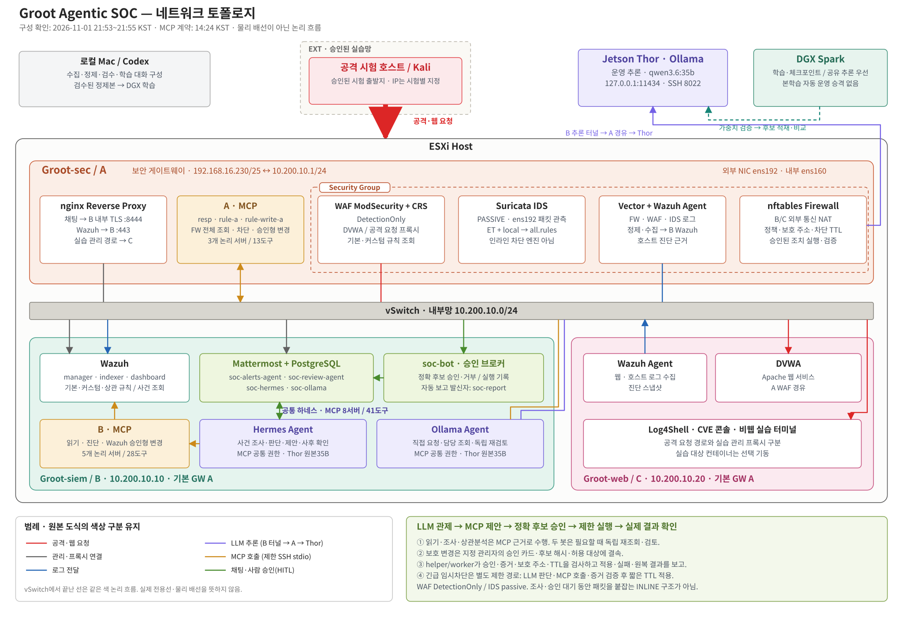
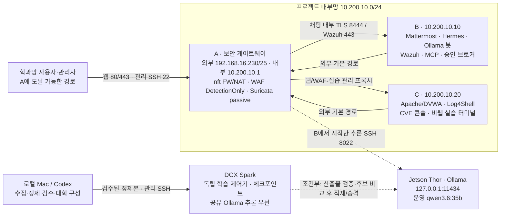
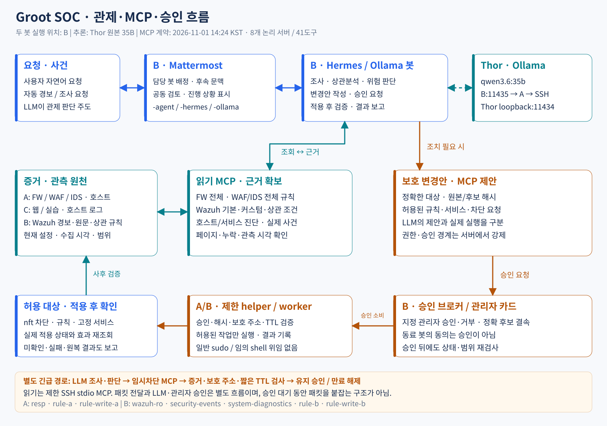
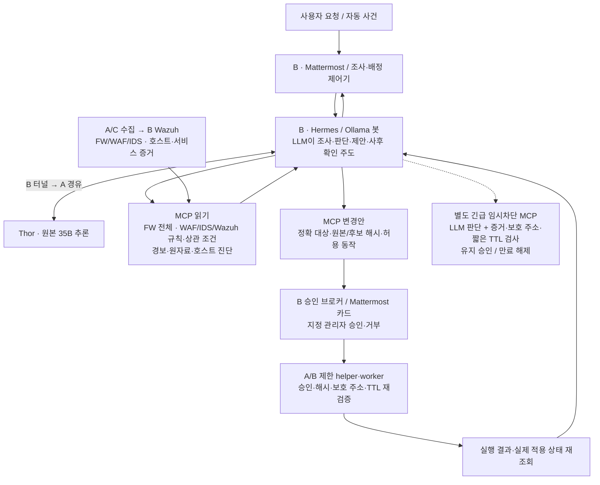

# 현재 토폴로지 — 2026-11-01

**A/B/C·Thor는 11/1 21:53~21:55 KST 관리 SSH 읽기 조회 기준**이다. 주소·기본 경로, 실행 서비스, Nginx 유효 설정, WAF/IDS 모드, 두 봇의 모델 설정과 Thor API를 대조했다. DGX 학습 상태는 **21:23 KST 별도 확인 기록**, MCP 목록은 **14:24 KST 라이브 계약 8개 서버·41도구**를 사용했다. 학습 완료·모델 승격·모든 경로의 공격 E2E를 확인했다는 뜻은 아니다. [현재 현황](../../STATUS.md) · [실행 계획](../../PLAN.md).

## 서버와 네트워크

**형식 기준:** 사용자 정정에 따라 `topology/`의 기존 ESXi·Groot-sec·vSwitch·Groot-siem/Groot-web 상세형과 SVC/vNIC·INT/EXT 버스형을 사용한다. 두 SVG와 재생성 소스는 [topology/](../../topology/README.md)에 둔다. 아래 구성 사실은 직전 조회 근거를 유지하며 형식 수정 중 서버 재조회·변경은 하지 않았다. 기존 ESXi 경계는 과거 배치 문서 근거이며 이번 게스트 SSH 조회를 하이퍼바이저 확인으로 확대하지 않는다.

[상세형 SVG](../../topology/groot_soc_network_architecture.svg) · [버스형 SVG](../../topology/groot_soc_topology_bus.svg).

상세형에서 Hermes와 Ollama 각각의 채팅·A/B MCP·추론 화살표를 확인할 수 있다. MCP와 추론은 각각 공통선과 짧은 봇별 분기로 표시해 중복 우회를 줄였다. 장비 배치·문구·색상과 버스형은 유지한다. [화살표·연결점·교차 구분](../../topology/README.md).

SVG는 확대 가능한 벡터 문서다. 아래 Mermaid는 연결 관계의 텍스트 원본이다. 선은 논리 경로이며 실제 케이블·스위치 배선이나 전용선을 뜻하지 않는다. Docker 내부 브리지는 호스트별로 존재하지만 그림에서는 생략했다.

| 위치 | 현재 역할·연결 | 확인 범위 |
|---|---|---|
| A | `ens192=192.168.16.230/25`, `ens160=10.200.10.1/24`, 기본 GW `192.168.16.129` | FW/NAT, WAF·chatproxy·Suricata 컨테이너, Vector·Wazuh agent 실행 확인 |
| B | `ens160=10.200.10.10/24`, 기본 GW A | Mattermost/Postgres·Wazuh 3종·Hermes 컨테이너, Ollama 채팅·공동 검토·승인 서비스 실행 확인 |
| C | `ens160=10.200.10.20/24`, 기본 GW A | Apache·Log4Shell·CVE 콘솔/제한 브로커·비웹 터미널·Wazuh agent 실행 확인. 선택 실습 컨테이너 전체가 상시 실행 중인 것은 아님 |
| Thor | Ollama는 `127.0.0.1:11434`에 수신 | 현재 적재 모델 `qwen3.6:35b`. 과거 학습 후보도 등록되어 있으나 두 봇 운영 설정은 원본 유지 |
| DGX | 학습과 실행 검증, 체크포인트·가중치 산출 | 21:23 관측에서 공유 모델 적재로 학습 대기. Mac/SSH와 독립된 제어기 유지. 봇의 현행 추론 목적지는 Thor |
| 로컬 | 원자료 수집·정제·검수·학습 대화 구성 | 정제본을 검수 후 반입. [전체 원본1개·정제본1개 압축 보관 정책](../../datasets/STORAGE_POLICY.md); 기존 자료의 일괄 압축 이전은 아직 미실행 |

**추론의 실제 경로:** B의 두 봇 → `10.200.10.10:11435` → B의 `capstone-inference-tunnel.service` → A를 경유한 목적지 제한 SSH(8022) → Thor의 `127.0.0.1:11434`. Hermes는 `/v1`, Ollama 봇은 native API를 사용한다. 같은 모델을 호출하더라도 봇 실행부·하네스와 추론 서버는 별개다. 이번에 tags/ps 읽기를 확인했으며 새 생성 요청은 보내지 않았다. [추론 전송·설치 경로](../../deployment/inference-transport.md).

**웹 경로:** A의 443 chatproxy에서 채팅은 B의 내부 TLS `8444`, Wazuh는 B의 `443`으로 연결된다. DVWA/공격 요청 경로는 A WAF에서 C 웹으로 전달된다. Log4Shell의 실습 관리 콘솔·세션 경로에는 C로 직접 연결하는 프록시도 있으므로 모든 URL이 WAF를 지난다고 표시하지 않는다. Nginx 유효 설정 조회이지 URL별 재시험 결과는 아니다.

**관리 경로:** B/C의 옛 외부 `.231/.232` 연결을 사용하지 않고 A를 SSH 점프 호스트로 사용한다. 웹의 출발지 허용과 SSH/Wazuh 관리 허용은 별도 정책이다. “프로젝트 외부”는 학과 실습망이며 인터넷에 무제한 공개됐다는 뜻이 아니다. GPU 서버의 접속 주소·계정은 로컬 자격파일을 따른다.

## 관제·MCP·승인 흐름

| MCP 실행 위치 | 논리 서버 | 등록 도구 수 |
|---|---|---:|
| A | `resp` / `rule-a` / `rule-write-a` | 4 / 5 / 4 |
| B | `wazuh-ro` / `security-events` / `system-diagnostics` | 14 / 4 / 2 |
| B | `rule-b` / `rule-write-b` | 5 / 3 |
| 합계 | **8개 논리 서버** | **41** |

목록 기준은 [11/1 MCP 계약](../../finetuning/mcp_contract.20261101.json)이다. 개수는 컨테이너 수가 아니며 요청 역할에 따라 노출 도구는 줄어든다. 실제 전달은 제한 SSH 계정의 stdio MCP이며 모든 MCP가 HTTP 포트로 상주하는 구성은 아니다. FW 전체 조회는 기존 `resp/get_firewall_rules`에 통합되어 별도 FW 서버를 늘리지 않았다. [장비별 전체·상관 규칙 조회](../mcp/security-rule-inventory.md) · [호스트 승인 작업](../mcp/host-service-actions.md).

- 두 봇은 B에서 실행된다. 공용 채널의 일반 조회는 담당 봇이, 중요 변경·불확실 사건·명시적 상호 검증은 두 봇이 정해진 범위에서 처리한다. `-agent`/`-hermes`/`-ollama` 접미사 정책과 사용자 후속 문맥을 유지한다. [채널·담당 정책](../hermes/chat-channels.md).
- LLM이 관제 주체다. 수집기·Native AR는 사건을 전달하고 worker는 정해진 권한으로 실행한다. 동료 봇의 동의나 모델의 “승인됨” 문장이 관리자 승인을 대신하지 않는다.
- 보호 변경은 승인에 결속된 정확 후보만 실행한다. 긴급 임시차단은 별도 제한 경로이며 LLM 조사·판단과 MCP 호출, 서버의 증거/보호 주소/TTL 검사가 선행한다. 일반 sudo·임의 shell·패키지 설치·컨테이너 재구성을 봇에 위임하지 않는다.
- 서비스 트래픽과 조사·승인은 서로 다른 흐름이다. 현재 WAF는 `DetectionOnly`, Suricata는 `ens192`의 passive IDS이며 `/rules/all.rules`를 읽는다. LLM·사람의 승인 시간 동안 패킷을 붙잡는 INLINE 구조로 표시하지 않는다. 실제 차단은 허용된 nft 경로와 실행 검증으로 구분한다.
- 로그 수집/서비스 실행 확인은 모든 사건 수집 무손실·탐지/상관 성공·실제 차단 성공의 증명이 아니다. 이번에는 승인 카드 게시·클릭, 공격, 변경, 모델 생성, 서비스 재시작을 하지 않았다.

## 학습 경로와 아직 배포하지 않은 구성

**로컬 수집·정제·검수 → 검수된 학습 입력 DGX 반입 → 학습·산출물 무결성 → 동일 조건 품질 비교 → Thor 후보 적재·검증 → 근거가 있을 때 운영 승격** 순서다. 후보 적재 전후에 각각 호환성과 품질을 확인하며 현재 본학습 산출물을 자동 운영 승격하지 않는다. 기존 Thor 후보 등록과 진행 중 DGX 본학습은 다른 실행이다. 가중치는 Git/Git LFS에 넣지 않는다.

DGX 일반 모델과 Thor 학습본에 두 봇을 나누는 자동 추론 분산, Thor 선처리 후 DGX 추론, vLLM/SGLang 전환은 현행 연결이 아니다. [이전 분산 검토안](../hermes/dual-inference-plan.md), [학습·적재 계획](../../finetuning/DGX_TRAINING_THOR_INFERENCE.md)을 참고한다. 프로젝트 SSL VPN·모바일 푸시도 기존 보류 범위다.

## 근거·변경 이력

- 라이브 읽기: A/B/C 주소·경로/서비스, WAF `SecRuleEngine`, Suricata 실행 인자, A의 `nginx -T`, B 모델/터널 설정과 API tags, Thor listener/ps. 민감값 없는 상세 영수증은 로컬 `대화기록/검증/2026-11-01-topology/`에 보존한다.
- 위 라이브 읽기와 [학습 실행 원장](../../finetuning/OPERATOR_TRAINING_RUN_20261101.json)·[MCP 계약](../../finetuning/mcp_contract.20261101.json)을 구분한다. 이번 도식 업데이트는 서버 설정·보안 정책·학습 실행을 변경하지 않았다.
- [10/8 도식·프롬프트와 후속 기록](history-20261008.md)은 역사 자료로 보존한다. 예전 DGX 추론/단일 봇/5 MCP 표기를 현재 구성으로 읽지 않는다. `topology/`의 원본 PNG는 형태 기준으로 보존하되 내용은 과거 기록이다. [최신 상세형·버스형과 원본의 구분](../../topology/README.md)을 따른다.
