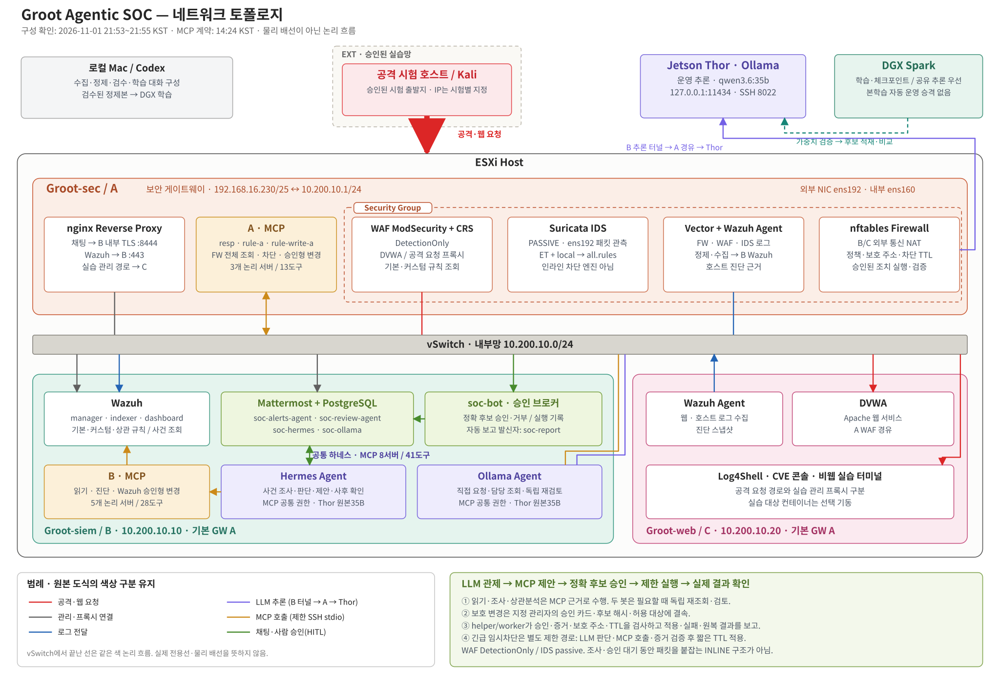
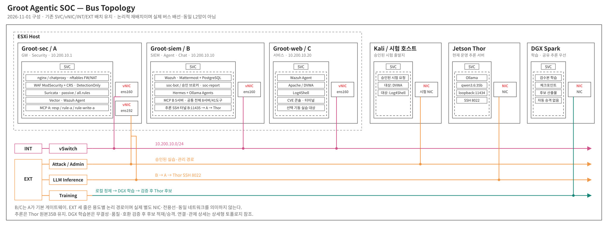

# Groot SOC 토폴로지

2026-11-01 사용자 지시에 따라 **이 폴더의 기존 상세형·버스형 도식 형태를 최신 토폴로지의 기준**으로 사용한다. 상세형은 ESXi 경계, 상단 Groot-sec, 중앙 vSwitch, 하단 Groot-siem/Groot-web, 외부 시험·GPU 노드를 유지한다. 버스형은 SVC/vNIC 상자와 INT/EXT 용도별 가로선을 유지한다. 색상도 원본의 공격 빨강·관리 회색·로그 파랑·추론 보라·MCP 주황·승인 초록을 따른다.

**동일한 내용은 그대로 유지하고 실제 변경된 부분만 수정한다.** 장비 상자·설명·색상과 버스형을 유지하고 상세형의 화살표만 정리했다. 두 봇의 짧은 분기를 위쪽 MCP 공통선과 아래쪽 추론 공통선에 연결해 중복 우회선을 없앴다. 필요한 회전은 둥글게 처리하고 공통 하네스 설명은 같은 문구로 위치만 조정했다.

| 봇별 연결 | 표시 |
|---|---|
| Mattermost ↔ Hermes / Ollama | 각 봇에 초록 화살표 |
| Hermes / Ollama ↔ A/B MCP | 각 봇의 짧은 주황 분기 → 공통선 → B MCP 및 vSwitch/A MCP |
| Hermes / Ollama ↔ Thor | 각 봇 아래의 짧은 보라 분기 → 공통선 → vSwitch/A → Thor |

경로 양 끝의 화살표는 요청·결과의 논리 흐름이다. 승인 권한이나 새로운 네트워크 접속을 추가한 것은 아니다. 같은 색 분기의 작은 점은 연결을, 다른 색 선과 만나는 곳의 짧은 틈은 연결 없는 교차를 표시한다. 공통선은 같은 목적지로 향하는 논리 경로를 묶은 것으로 새로운 MCP 중계 서버·물리 링크를 뜻하지 않는다.

| 현재 도식 | 기존 형태 기준 |
|---|---|
| [상세 네트워크 토폴로지](groot_soc_network_architecture.svg) | `groot_soc_network_architecture_preview.png` 및 같은 구조의 `groot_soc_topology_slide.png` |
| [버스형 토폴로지](groot_soc_topology_bus.svg) | `groot_soc_topology_bus_preview.png` |





내용은 직전21:53~21:55 KST A/B/C·Thor 조회와14:24 MCP 계약을 유지한다. 두 봇은B, 추론은B 제한SSH터널→A→Thor 원본35B, 학습은DGX이며 로컬에서 수집·정제·검수한다. MCP는A3/B5개의 총8개 논리 서버·41도구다. 이번에는 서버를 다시 점검하거나 설정을 변경하지 않았다. [주소·실제 경로·조회 근거·한계](../infra/diagrams/README.md) · [현재 현황](../STATUS.md).

버스는 논리적 재배치이며 실제 물리 배선·추가 NIC·동일 L2망을 뜻하지 않는다. Kali는 승인된 시험 역할을 나타내며 이번에 특정 공격 VM의 실행이나 도구 설치를 확인한 것은 아니다. 상단 ESXi 그룹은 기존 배치 문서의 가상화 경계이고 이번 게스트 SSH 확인이 하이퍼바이저 직접 점검을 대신하지 않는다. 기존 그림의 `5 MCP`/단일 Hermes/DGX 단독 추론/Log4Shell 평시OFF 표기는 최신 도식에 옮기지 않았다. WAF는DetectionOnly, IDS는passive이며 정확 후보 승인과 제한적 긴급 임시차단 경로를 구분했다.

## 수정·재생성

SVG는 확대한 글자와 주소를 정확히 유지하는 편집 가능한 원본이다. [render_current.py](render_current.py)에 배치·문구를 수정하고 다음 명령으로 두 도식을 함께 재생성한다. Python 표준 라이브러리만 사용하며 패키지 설치·외부 API 호출·기존 PNG 편집은 없다.

```sh
python3 -B topology/render_current.py
```

관제 승인 순서를 따로 설명한 [보조 흐름도](../infra/diagrams/current-soc-flow.svg)는 유지한다. 직전 새 카드형 네트워크 도식은 기존 형태를 사용하라는 사용자 정정에 따라 현재 참조에서 교체했다. 이전 버전은 Git 커밋 `b05381f`에서 복구할 수 있다.

## 역사 자료

입력 PNG3개와 `update_rule_mcp.swift`는 원형을 보존한다. 현재 구성으로 해석하지 않는다. 이 Swift 스크립트는 당시5개 MCP의 라벨을 덧붙이는 과거 재현용이며 현재 SVG를 만들 때 사용하지 않는다.

`*_rule_mcp.png` 출력3개는 Git에서 제외했다. 원본은 [정리 복구본](../archive/REPOSITORY_CLEANUP.md)에 보존했고 기존 입력과 Swift 소스로 다시 생성할 수 있다. 이미지를 다시 만들 때는 별도 작업 디렉터리에 입력과 스크립트를 복사해 실행하며 운영 서버 설정을 변경하지 않는다.
